<a href="https://www.beebopcity.com">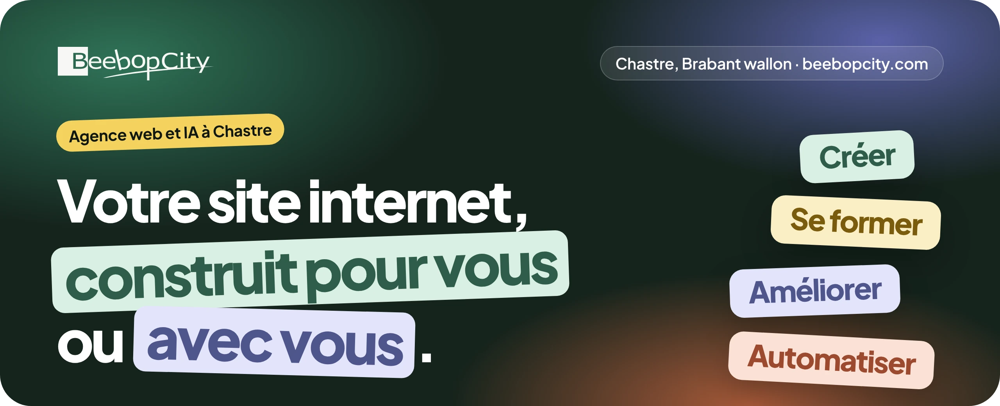</a>

**BeebopCity est une agence web et IA installée à Chastre, en Brabant wallon.** Nous créons des sites internet, des boutiques en ligne et des applications pour les indépendants et les PME. Nous formons ceux qui veulent le faire eux-mêmes, nous améliorons les sites qui existent déjà et nous automatisons les tâches répétitives.

Le prix est annoncé par écrit avant de commencer. Vous avez un seul interlocuteur du début à la fin. Le site, le nom de domaine et le code restent à votre nom.

## Ce que nous faisons pour vous

<a href="https://www.beebopcity.com/services#creer">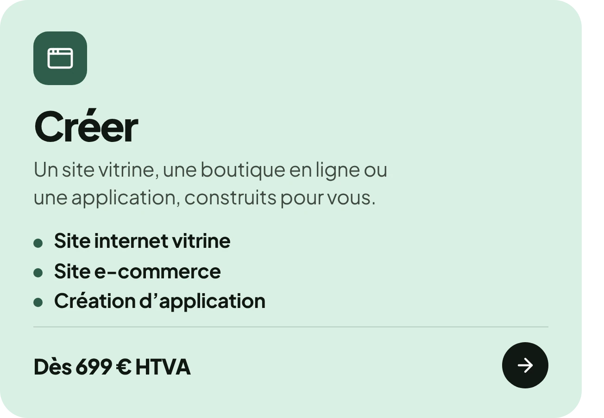</a>

<a href="https://www.beebopcity.com/services#ameliorer">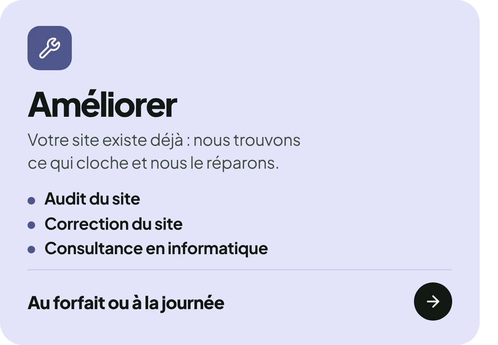</a><a href="https://www.beebopcity.com/services#automatiser">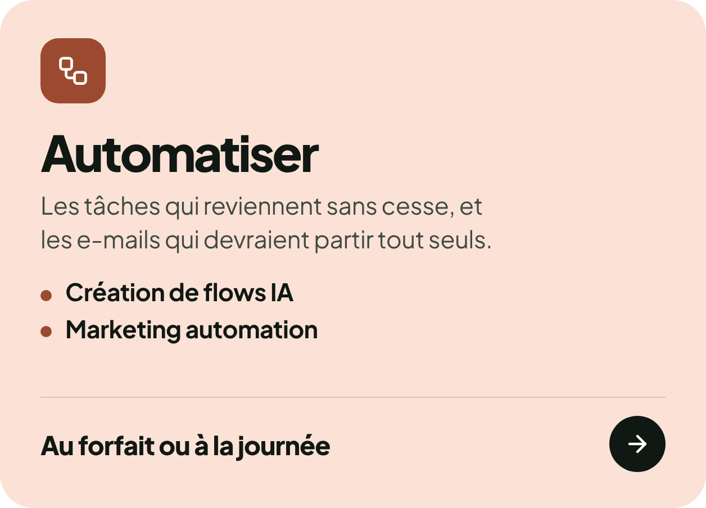</a>

<b>Le détail des services et des prix</b>

 

| Famille | Service | Prix |
| --- | --- | --- |
| Créer | [Site internet vitrine](https://www.beebopcity.com/services/site-vitrine) | Dès 699 € HTVA |
| Créer | [Site e-commerce](https://www.beebopcity.com/services/site-e-commerce) | Sur devis |
| Créer | [Création d’application](https://www.beebopcity.com/services/creation-application) | Sur devis |
| Se former | [Créer son site internet avec l’IA](https://www.beebopcity.com/formations/creer-son-site-avec-ia) | 499 € HTVA par personne |
| Se former | [L’IA au quotidien pour les PME](https://www.beebopcity.com/formations/ia-au-quotidien) | 349 € HTVA par personne |
| Se former | [Automatiser ses tâches sans coder](https://www.beebopcity.com/formations/automatiser-sans-coder) | 499 € HTVA par personne |
| Améliorer | [Audit du site](https://www.beebopcity.com/services/audit-du-site) | Au forfait ou à la journée |
| Améliorer | [Correction du site](https://www.beebopcity.com/services/correction-du-site) | Au forfait ou à la journée |
| Améliorer | [Consultance en informatique](https://www.beebopcity.com/services/consultance-informatique) | Au forfait ou à la journée |
| Automatiser | [Création de flows IA](https://www.beebopcity.com/services/flows-ia) | Au forfait ou à la journée |
| Automatiser | [Marketing automation](https://www.beebopcity.com/services/marketing-automation) | Au forfait ou à la journée |

La journée est à 850 € HTVA, sur place ou à distance, sans abonnement ni engagement. Tous les prix sont sur [la page des offres](https://www.beebopcity.com/nos-offres).

## Ils nous ont confié leur site

<a href="https://www.beebopcity.com/realisations/greenside-garden">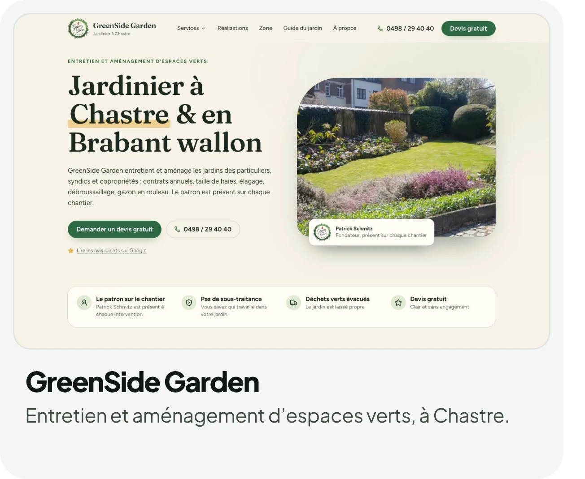</a><a href="https://www.beebopcity.com/realisations/thybati">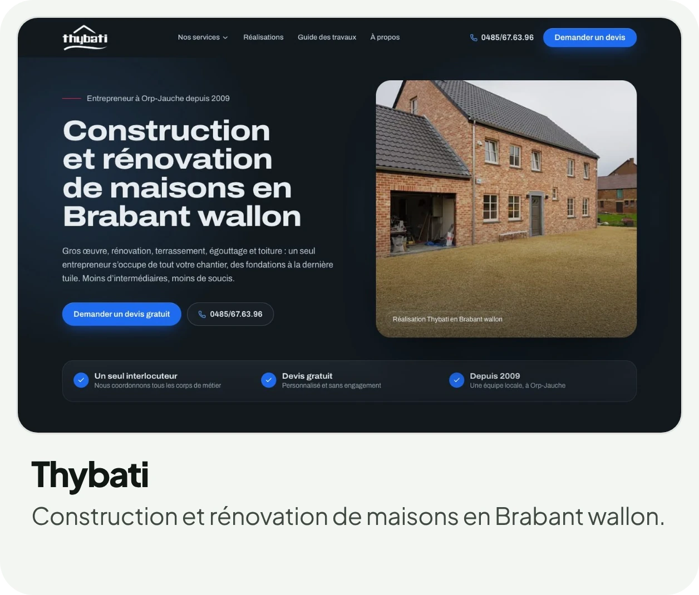</a>

<a href="https://www.beebopcity.com/realisations/labographie">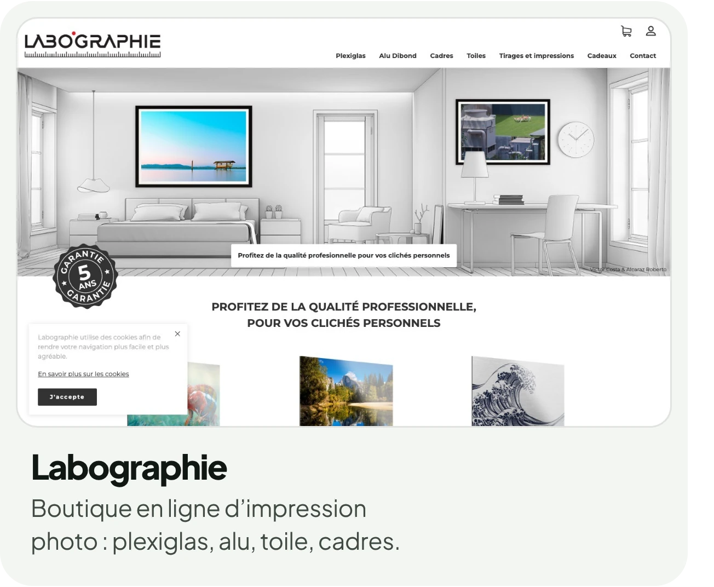</a>

## BeebopCity Projects

À côté des sites de nos clients, nous sortons nos propres produits. Nous les concevons, nous les mettons en ligne et nous les faisons tourner tous les jours. Ce que nous y apprenons profite ensuite à chaque projet client.

<a href="https://www.beebopcity.com/projects/belltime">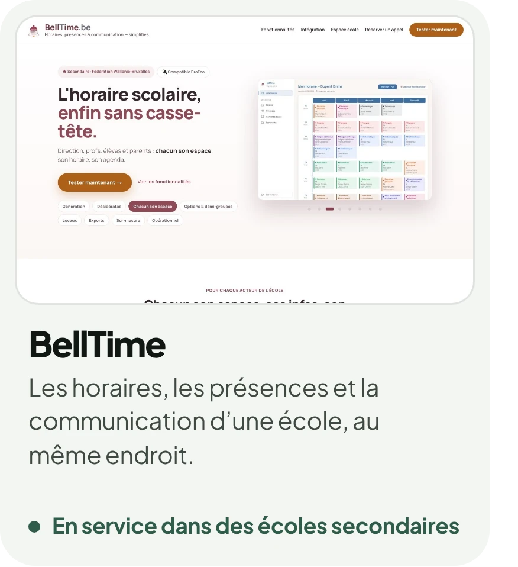</a><a href="https://www.beebopcity.com/projects/interactive-pitlane">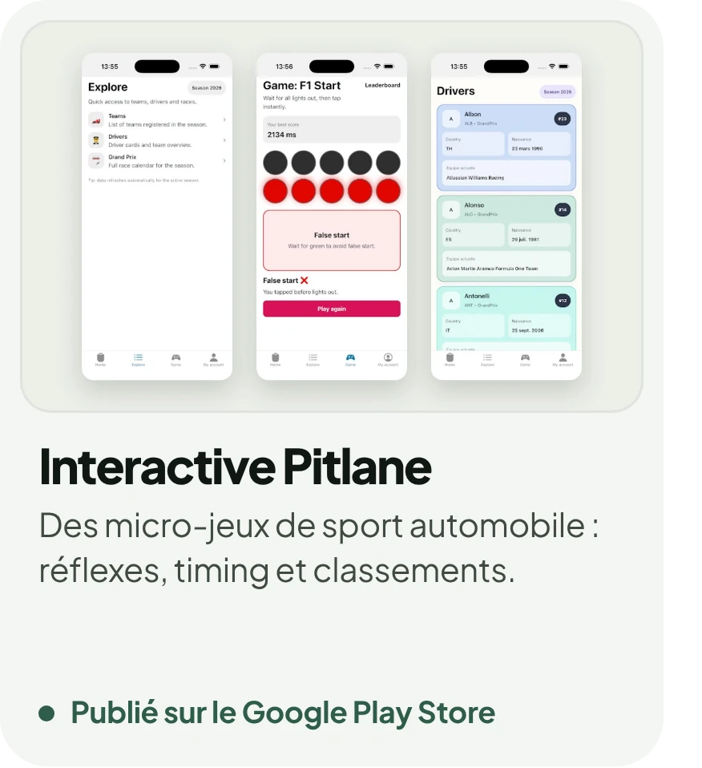</a><a href="https://www.beebopcity.com/projects/tinned">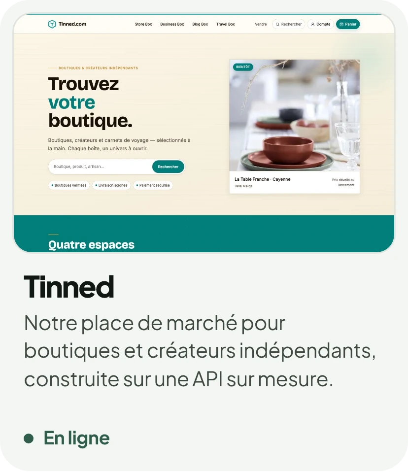</a>

## Avec quoi nous construisons

Next.js · TypeScript · React Native (Expo) · PHP · Symfony · API Platform · Python

<a href="https://calendly.com/olivier-vangest/coffee-time">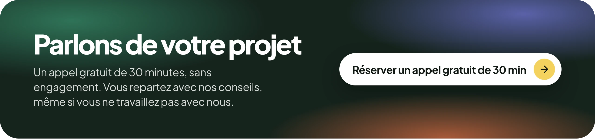</a>

  <a href="https://www.beebopcity.com">beebopcity.com</a> ·
  <a href="mailto:info@beebopcity.com">info@beebopcity.com</a> ·
  <a href="https://www.linkedin.com/company/beebopcity/">LinkedIn</a> ·
  <a href="https://www.facebook.com/beebopcity/">Facebook</a>

BeebopCity SRL, BCE 0676.701.890. Chastre, Brabant wallon.

